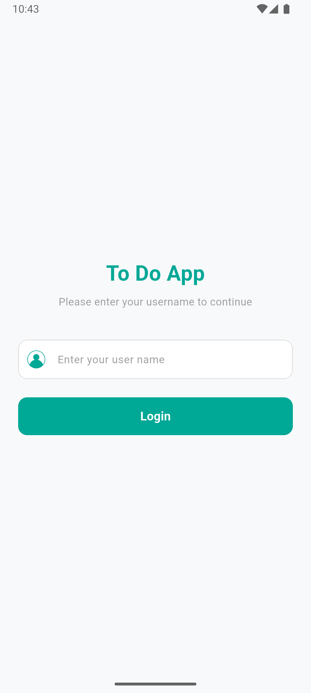
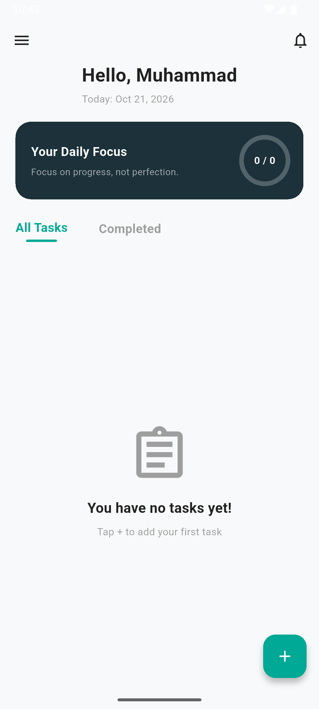
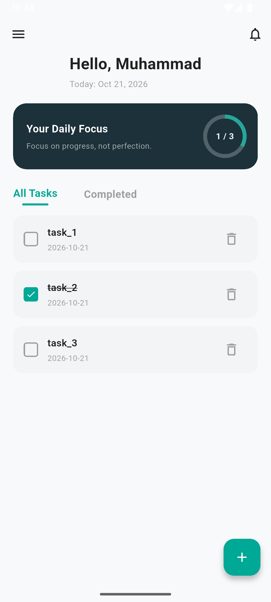
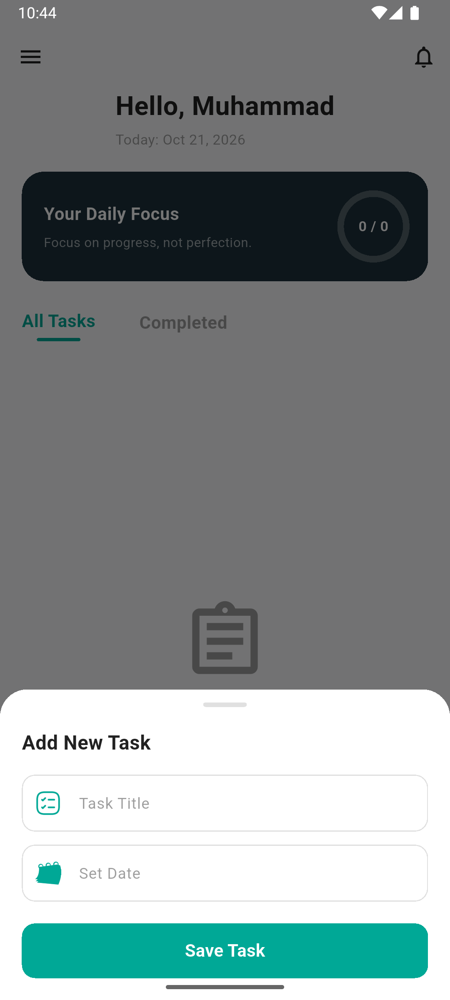
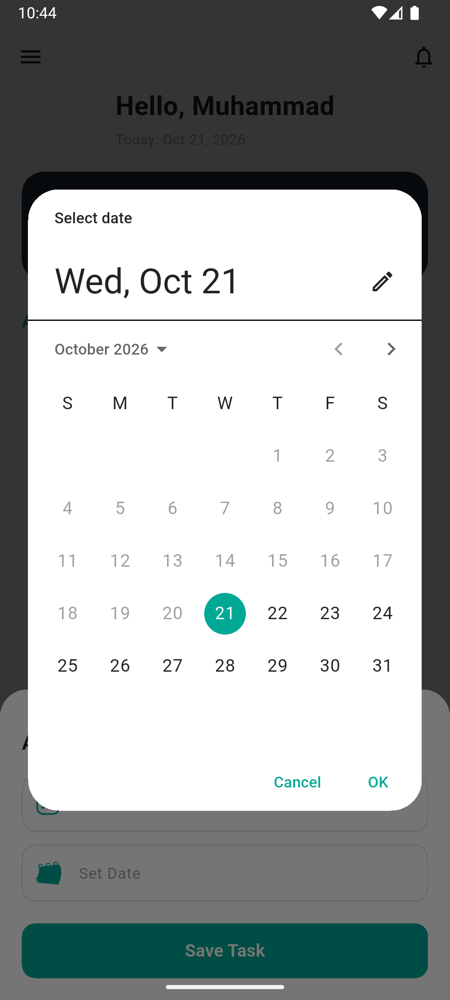
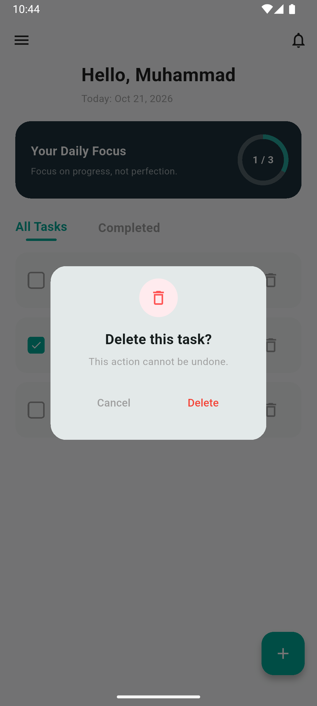
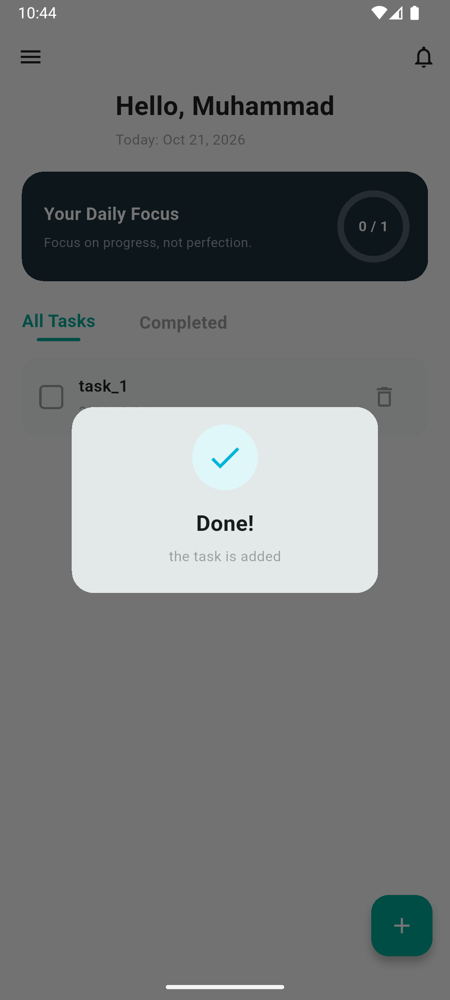
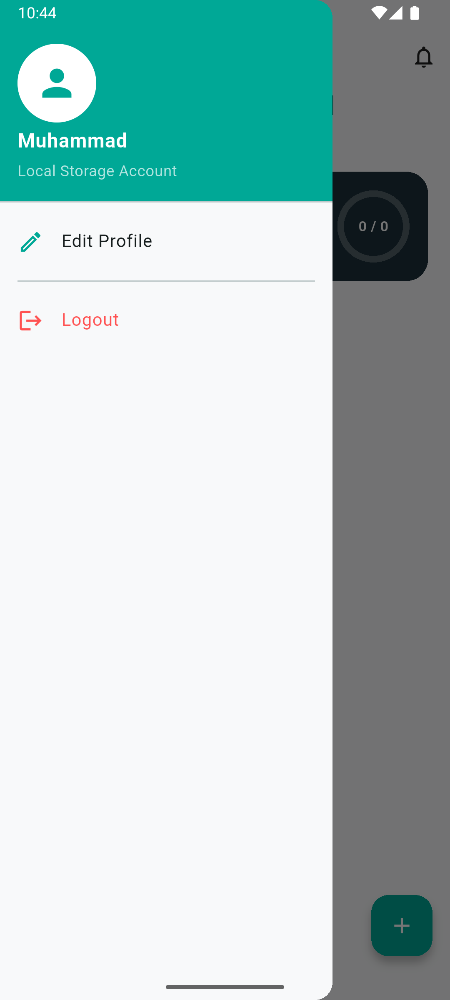

<div align="center">

  # 📝 To-Do App — Offline First Task Manager

  **A modern, intuitive, and performant Task Management application built with Flutter, BLoC/Cubit, and Hive persistence.**

  
  
  
  

</div>

---

## 📌 Project Overview

The **To-Do App** is an offline-first productivity client engineered to offer a seamless, high-performance task tracking experience. It addresses common local persistence bottlenecks by utilizing **Hive NoSQL**, ensuring instant boot-ups and state restoration without redundant cloud or authentication latency.

Designed adhering to modern UI/UX principles, the application provides intuitive visual focus metrics, dynamic filtering, real-time local state mutations, and a clean interface calibrated with a primary brand identity (`#00A896`).

---

## 📱 App Screenshots

<div align="center">

| Login Screen | Home View | Daily Progress Focus |
| :-: | :-: | :-: |
|  |  |  |

| Add New Task | Date Picker | Delete Confirmation |
| :-: | :-: | :-: |
|  |  |  |

| Action Completed | Drawer Navigation |
| :-: | :-: |
|  |  |

</div>

---

## ✨ Key Features

- ⚡ **Offline-First Persistence:** Instant local synchronization powered by Hive NoSQL DB.
- 👤 **Seamless Onboarding:** Fast single-step username creation with session caching.
- 🎯 **Daily Focus Metrics:** Visual progress indicators calculating daily completion percentages dynamically.
- 🗓️ **Native DatePicker:** Enhanced UX for deadline selection utilizing native date pickers.
- 🔍 **Task Filtering:** Categorized view management dividing tasks between **All Tasks** and **Completed**.
- 💬 **Interactive Feedback:** Custom alert dialogs for confirmation states (Adding, Deleting).
- 🎨 **Unified Design System:** Consistent custom components (`CustomTextField`, `CustomButton`, `CustomDrawer`).

---

## 🏗️ Technical Architecture & Tech Stack

The application follows a modular, state-driven architecture separating data persistence, business logic, and UI layout layers.

| Purpose | Technology / Package |
| :--- | :--- |
| **Framework** | Flutter (Material 3) |
| **Language** | Dart |
| **State Management** | `flutter_bloc` (Cubit Pattern) |
| **Local Storage** | `hive`, `hive_flutter` |
| **Code Generation** | `build_runner`, `hive_generator` |
| **Formatting & Utilities** | `intl` |

---

## 👥 Engineering Team & Task Breakdown

The project implementation was distributed across specialized module owners for the **DEPI Initiative**:

| Role / Team Member | Engineering Area | Responsibilities |
| :--- | :--- | :--- |
| **Mohamed Khairy Roshdy Ali Ibrahim** *(Team Leader)* | **UI/UX & Design System** | Developed `HomeView`, `LogInView`, and standard component architecture (`CustomTextField`, `CustomButton`, `CustomDrawer`). |
| **Nour Amr Mohamed Sabek** | **State Management** | Implemented Cubit controllers (`UserCubit`, `TasksCubit`) and application state emission patterns (`TasksStates`, `UserStates`). |
| **Amani Ahmed Hassan Ahmed** | **Data Layer & Storage** | Built Hive models (`TaskModel`, `UserModel`), TypeAdapters, local storage encryption/boxes, and auto-login logic. |
| **Malak Hany Sayed Ahmed** | **Feature Integration & QA** | Integrated native `showDatePicker`, modal bottom sheets, confirmation dialogs, and handled overall system error boundaries. |

---

## 📂 Project Structure

```text
lib/
├── cubit/
│   ├── task_cubit/
│   │   ├── tasks_cubit.dart
│   │   └── tasks_states.dart
│   └── user_cubit/
│       ├── user_cubit.dart
│       └── user_states.dart
├── models/
│   ├── task_model.dart
│   ├── task_model.g.dart
│   ├── user_model.dart
│   └── user_model.g.dart
├── views/
│   ├── completed_tasks_view.dart
│   ├── home_view.dart
│   └── log_in_view.dart
├── widgets/
│   ├── add_task_widget.dart
│   ├── custom_button.dart
│   ├── custom_drawer.dart
│   ├── custom_text_field.dart
│   ├── no_tasks_widget.dart
│   └── task_builder.dart
└── main.dart
assets/
└── screenshots/
    └── ...
```

### Folder Overview

- `cubit/` — Cubits responsible for managing application state.
- `models/` — Data models used by the app.
- `views/` — Main application screens.
- `widgets/` — Reusable UI components.
- `assets/` — Images and other static resources.

## 🚀 Getting Started

### Prerequisites

Make sure you have installed:

- [Flutter SDK](https://docs.flutter.dev/get-started/install)
- [Dart SDK](https://dart.dev/get-dart) (included with Flutter)
- Android Studio, VS Code, or another supported IDE

### Installation

1. Clone the repository:

   ```bash
   git clone <YOUR_REPOSITORY_URL>
   ```

2. Open the project directory:

   ```bash
   cd <PROJECT_DIRECTORY>
   ```

3. Install dependencies:

   ```bash
   flutter pub get
   ```

4. Run the app on an emulator or connected device:

   ```bash
   flutter run
   ```

## 🧪 Run Checks

Analyze the project for potential issues:

```bash
flutter analyze
```

Run tests, if available:

```bash
flutter test
```

## 🗺️ Roadmap

Possible improvements for future versions:

- Add more task-management capabilities.
- Improve validation and error handling.
- Add automated tests for Cubits and widgets.
- Refine the UI for different screen sizes.

## 🤝 Contributing

Contributions and suggestions are welcome. To propose a change, open an issue or submit a pull request.

## 👨‍💻 Author

**Muhammad Khairy**

- GitHub: [@Muhammadkhiry](https://github.com/Muhammadkhiry)

---

If you find this project useful, consider giving the repository a ⭐.
